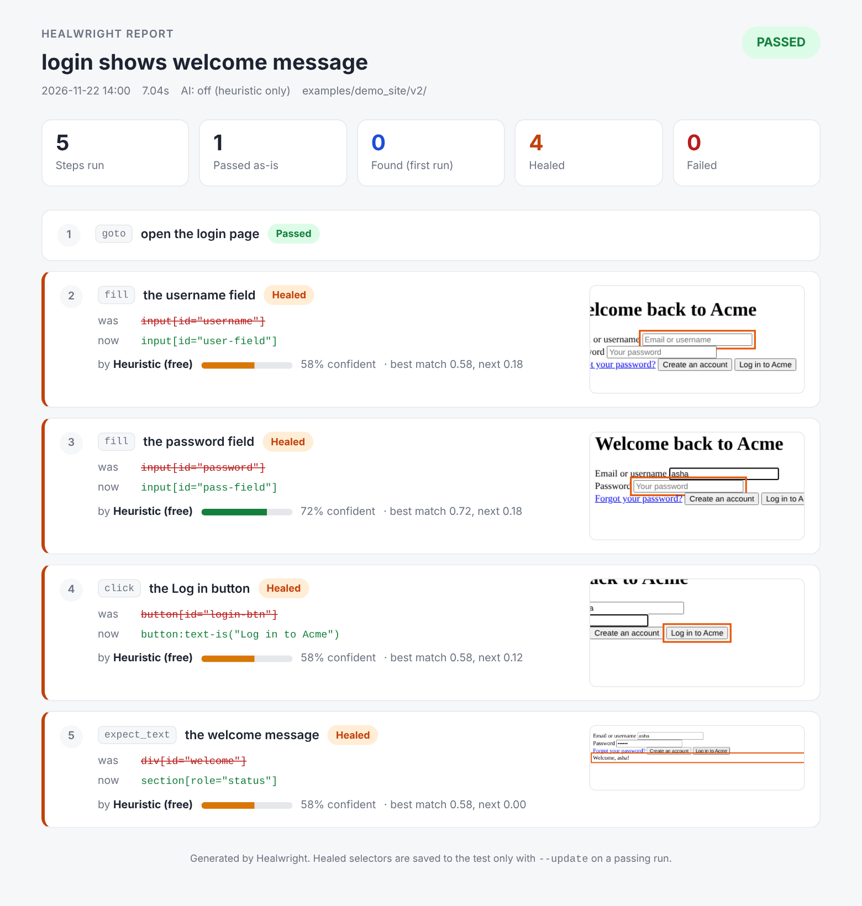

# Healwright


**Self-healing Playwright tests, written in plain English.**

UI tests break every time someone renames a CSS class. Healwright tests describe *what*
you mean ("the Log in button"), not *where* it is (`#login-btn`). When the page changes,
Healwright finds the element again, tells you what it changed, and, if you say so,
saves the fix.

```
[PASS ] 1. goto           open the login page
[HEAL ] 2. fill           the username field
           -> input[id="user-field"]  (heuristic, confidence 0.58)
           was input[id="username"]
[HEAL ] 4. click          the Log in button
           -> button:text-is("Log in to Acme")  (heuristic, confidence 0.58)
           was button[id="login-btn"]
PASSED in 6.6s, 4 step(s) found/healed
```

## Why it's different
- **Heuristics first, AI second.** Most heals are free, offline and deterministic. An
  LLM is asked only when the scoring isn't confident, and it can only *pick* from real
  elements on the page, never invent a selector.
- **Refuses to guess.** If no element is a clear match, the step fails. A test tool that
  passes broken tests is worse than none.
- **You stay in control.** Heals are reported. The test file changes only with `--update`
  on a fully passing run.
- **No lock-in.** `healwright export` turns any test into plain pytest-playwright code.

## Quick start
```bash
pip install -e ".[dev]"
playwright install chromium

cp examples/login_test.yaml my_test.yaml
healwright run my_test.yaml --base-url "file://$PWD/examples/demo_site/v1/" --update  # learn
healwright run my_test.yaml --base-url "file://$PWD/examples/demo_site/v2/"           # heal
```
`v2` is a "redesign" of `v1` in which every id, name, class and button label has changed.

## Writing a test
```yaml
name: login shows welcome message
steps:
- {action: goto,        intent: open the login page, value: login.html}
- {action: fill,        intent: the username field,  value: asha}
- {action: fill,        intent: the password field,  value: s3cret}
- {action: click,       intent: the Log in button}
- {action: expect_text, intent: the welcome message, value: "Welcome, asha!"}
```
Actions: `goto`, `click`, `fill`, `expect_text`, `expect_visible`.
`selector` and `fingerprint` are added automatically, so don't write them yourself.

Or generate one from a sentence (needs an LLM; see "Choosing an LLM"):
```bash
healwright plan "Log in as asha with password s3cret and check the welcome message" \
  --url login.html -o login.yaml
```

## Commands
| Command | What it does |
|---|---|
| `healwright run SPEC [--base-url URL] [--update] [--no-llm] [--headed] [--report out.json] [--html report.html]` | Run, heal, report |
| `healwright plan "DESCRIPTION" --url URL -o SPEC` | Plain English to test spec |
| `healwright export SPEC -o test_x.py` | Spec to plain Playwright test |

## Choosing an LLM (optional, and free options exist)
Healwright works with **no LLM at all**, because heuristic healing is free and offline. An LLM
only adds `plan` and a fallback for hard heals. Pick one by setting environment variables:

| Option | Cost | Setup |
|---|---|---|
| **Google Gemini** | Free tier, no card | Get a key at aistudio.google.com, then `export GEMINI_API_KEY=...` |
| **Ollama** (runs on your machine) | Free, offline | Install Ollama, `ollama pull llama3.2`, then `export HEALWRIGHT_PROVIDER=ollama` |
| **Anthropic Claude** | Paid credits | `export ANTHROPIC_API_KEY=...` |
| **Any OpenAI-compatible API** (Groq, OpenRouter, OpenAI ...) | Varies | `HEALWRIGHT_PROVIDER=openai-compatible`, `HEALWRIGHT_BASE_URL`, `HEALWRIGHT_MODEL`, `HEALWRIGHT_API_KEY` |

If no provider is named, Healwright looks for `ANTHROPIC_API_KEY`, then `GEMINI_API_KEY`.
`HEALWRIGHT_MODEL` overrides the model for any provider. Never commit keys.

## Visual HTML report
Add `--html report.html` to any run to get a single, self-contained page. Open it in any
browser, no internet needed. It shows every step, the old and new selector for each heal,
whether the free heuristic or the AI found it, how confident it was, and a screenshot of the
element it picked:

```bash
healwright run my_test.yaml --base-url "file://$PWD/examples/demo_site/v2/" --html report.html
open report.html        # macOS; on Windows: start report.html
```



## How it works
1. **Fingerprint:** after each successful step, store the element's tag, id, name, text,
   label, placeholder and classes.
2. **Detect:** on the next run, if the saved selector doesn't appear within 1.5s, start healing.
3. **Score:** compare every visible candidate with the fingerprint and the intent words.
   Accept only a confident winner with a clear lead.
4. **Fallback:** if unsure, ask the LLM to choose a candidate by number.
5. **Rewrite:** build the most stable unique selector (`data-testid` > `id` > `name` > ... > CSS path).

## Project layout
```
healwright/   spec.py  dom.py  healer.py  llm.py  runner.py  planner.py  cli.py
examples/     demo_site/v1, demo_site/v2, login_test.yaml
tests/        unit + real-browser end-to-end + LLM (fake provider)
docs/         DECISIONS.md (why), BUILD_LOG.md (what & how, per session)
```

## Roadmap
- [ ] GitHub Actions CI
- [ ] Live-test the LLM planner and healer
- [ ] HTML heal report (before/after)
- [ ] `select`, `hover`, iframes, shadow DOM
- [ ] Benchmark on real sites; publish heal accuracy
- [ ] TypeScript export
- [ ] Hosted dashboard (paid tier)

## Development
```bash
pytest -q
```
Read `docs/BUILD_LOG.md` before starting a session, and add to it when you finish.
Log every real choice in `docs/DECISIONS.md`.

## Ownership
© 2026 Harshit Mishra. All rights reserved.
You're welcome to read the code. Please ask before copying, reusing or redistributing it.
